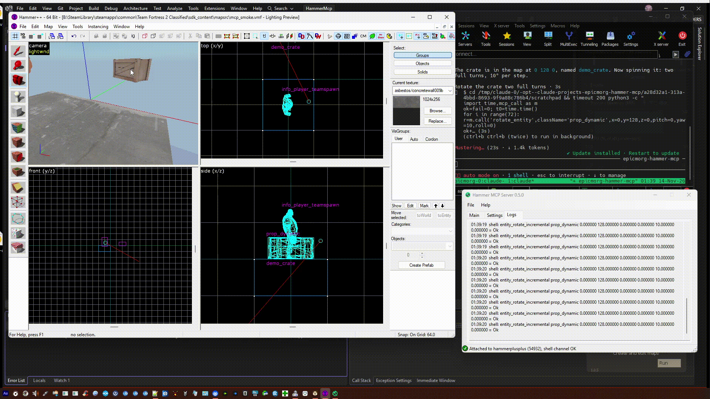

<p align="center">
  
</p>

<h1 align="center">Hammer-MCP</h1>

<p align="center">
  <b>Let AI agents see and edit maps in Valve Hammer Editor — live.</b><br>
  An <a href="https://modelcontextprotocol.io">MCP</a> server for Hammer (Source 1), <a href="https://github.com/ficool2/HammerPlusPlus-Website">Hammer++</a> and friends.
</p>

<p align="center"><b>English</b> · <a href="README.ru.md">Русский</a></p>

<p align="center">
  
  
  
  
  
  <a href="https://glama.ai/mcp/servers/EpicMorg/Hammer-MCP"></a>
</p>

---

Ask your agent *"put a warm light at each corner of the room and name them by the scheme"* — and watch the entities
appear in the Hammer you already have open. No plugins, no patched editor: Hammer-MCP talks to Hammer through the
**shell channel** that Valve built into the editor 20 years ago (`Worldcraft_ShellMessageWnd`, the mechanism behind
[`editor_sendcommand.cpp`](https://github.com/ValveSoftware/source-sdk-2013/blob/master/src/public/editor_sendcommand.cpp) in the Source SDK) and through Hammer's own menu commands.

<p align="center">
  <br>
  <sub>An agent spawns a <code>prop_dynamic</code> in Hammer++ and spins it - live, over MCP (<a href="docs/media/demo/demo.mp4">video</a>).</sub>
</p>

```
 AI agent (Claude Code, Cursor, …)
        │  MCP over HTTP (+ optional Bearer token, LAN-capable)
        ▼
 ┌────────────────────────────┐      WM_COPYDATA  (shell channel: entities, keyvalues, nodes)
 │  hammer-mcp.exe  (tray)    │ ───► WM_COMMAND   (menu: save, undo, redo, run map, …)        ──►  Hammer / Hammer++
 │  process attach · settings │ ───► reads the saved .vmf (map summary, mapversion)
 │  live log                  │
 └────────────────────────────┘
```

## What works today

Verified live on **[Hammer++](https://github.com/ficool2/HammerPlusPlus-Website) 8873** x64 ([TF2 Classified](https://store.steampowered.com/app/3545060/)) and x86 (Source SDK 2013 SP mod), from an agent on another machine over the LAN:

| | |
|---|---|
| ✅ Create point entities with keyvalues (`light`, `info_target`, `prop_dynamic` with a model, …) | ✅ Rotate entities (a spinning locker at ~28 edits/s, Hammer stays responsive) |
| ✅ Set keyvalues, delete entities | ✅ Edits land in Hammer's **undo** history — Ctrl+Z works |
| ✅ Save / undo / redo / Run Map / Check for Problems via menu commands | ✅ Map summary from the saved `.vmf` (entities, brushes, classes, skybox…) |
| ✅ Recognises the running Hammer build by hash (registry of 183 known builds) | ✅ Token auth, localhost by default |
| ✅ Map knowledge: entities, outputs, I/O graph, validation against the game's FGD | ✅ Compile with Hammer's own Run Map sequences, parsed log, leak trace, compiled `.bsp` entities |

### Screenshots

| Pick a Hammer process | Attached: build, shell channel | Live log of the demo |
|---|---|---|
|  |  |  |

## Supported editors

The shell channel exists in **every stock Source Hammer since 2006** and in **Hammer++ since build 8867**;
menu command ids are identical across **all 152 Source Hammer builds** we analysed. From the next release (0.9) the
adapter also reads the live selection and 3D camera on builds with a known memory layout.

| Editor | Live edits (shell) | Menu commands | Selection & camera (adapter, 0.9) | Map files |
|---|:---:|:---:|:---:|:---:|
| [Hammer++](https://github.com/ficool2/HammerPlusPlus-Website) 8867+ (all games, x86 & x64) | ✅ | ✅ | ✅ | ✅ |
| Hammer++ ≤ 8866 | — | ✅ | ✅ | ✅ |
| [Source Level Editor](https://developer.valvesoftware.com/wiki/Source_Level_Editor_(SLE)) 3.129 | ✅ | ✅ | ✅ | ✅ |
| Stock Hammer, 2013 branch and newer — SDK 2013 SP/MP, HL2, TF2, CS:S, HL1, GMod, … (x86 & x64) | ✅ | ✅ | ✅ ² | ✅ |
| Stock Hammer, older branches — EP1, Orange Box, L4D/L4D2, Portal 2, Alien Swarm, CS:GO, … | ✅ | ✅ | in progress | ✅ |
| [Slammin' Hammer 5.2](https://developer.valvesoftware.com/wiki/Slammin'_Source_Map_Tools), Black Mesa, Nuclear Dawn | ✅ | ✅ | ✅ ¹ ² | ✅ |
| [Strata](https://github.com/StrataSource) Hammer (Portal: Revolution, P2CE, …) | — | ✅ | — | ✅ |
| Source 2 Hammer (CS2, Dota 2, …) — recognised, `.vmap` and FGD read, unsaved state via VConsole2 | — | — | — | ✅ read |
| GoldSrc: Hammer 3.4 / 3.5 and its mods (Neon, Neo, CSM) | — | ✅ | ✅ | RMF / MAP read |
| GoldSrc: Worldcraft 1.1–3.3; [J.A.C.K.](https://store.steampowered.com/app/496450/) | — | partly | — | RMF / MAP read |

¹ Slammin' and Black Mesa only; Nuclear Dawn is in progress.
² Memory layout derived from the binaries; live check pending.

Checked live so far (0.9 development builds): Hammer++ 8873 (x64 and x86) and 8862, Source Level Editor 3.129, Valve Hammer Editor 3.4 and 3.5,
CS2; the rest comes from static analysis of the binaries. Per-build details, what is live-checked and what is not:
**[editor support matrix](docs/editors.md)**. Reports for other builds are very welcome.

## Quick start

1. Download/build `hammer-mcp.exe` and run it — it lives in the tray.
2. **Settings:** pick a mode, address (`localhost` by default), port (`47800`), generate a token for LAN use → **Apply**.
3. **Main:** choose your Hammer process → **Attach** (meta info shows the build, shell channel, open map) → **Start**
   (Start needs an attached process; Apply on the Settings tab lights up only when something changed).
4. Connect your agent — tray menu → *Copy client config*:
   ```bash
   claude mcp add --transport http hammer http://127.0.0.1:47800/mcp
   # LAN:   ... http://10.0.0.5:47800/mcp --header "Authorization: Bearer <token>"
   ```
5. Open a map in Hammer and **save it** (sessions are bound to the saved `mapversion`). Ask away.

### Without the tray app: `hammer-mcp-cli`

The release also has `hammer-mcp-cli.exe` - the same server for MCP clients that start servers themselves (stdio):

```json
{ "mcpServers": { "hammer": { "command": "C:\\Tools\\hammer-mcp-cli.exe", "args": ["--stdio", "--auto"] } } }
```

`--auto` attaches to the first running Hammer with a shell channel, `--pid N` to a given process; `--mode Basic` is read-only;
`--http --port 47800` serves HTTP like the app. A `Dockerfile` builds it for MCP catalogs (Hammer itself needs Windows).

## Tools for the agent

| Tool | What it does |
|---|---|
| `hammer_status` | Which Hammer is attached, its build, shell channel, open map, saved `mapversion`, allowed mode |
| `map_summary` | Saved `.vmf`: versions, entity/brush counts, classes, skybox, visgroups |
| `list_entities` · `get_entity` · `find_io` | Saved map: entities with keyvalues and outputs, who triggers whom |
| `game_configs` · `fgd_class` · `fgd_search` | Hammer's game config and the game's FGD as an entity reference (keyvalues, choices, inputs, outputs) |
| `validate_map` | Saved map vs FGD: unknown classes, outputs to missing names, unknown inputs / outputs, extra keyvalues |
| `check_assets` | Materials, models, overlays, decals, skybox, sounds and sound script names of the saved map vs the game's search paths (gameinfo.txt, folders, VPKs) |
| `compile_sequences` · `compile_log` · `leak_trace` | Hammer's own Run Map sequences (CmdSeq.wc / Hammer++ / Strata / J.A.C.K.), parsed compile log, leak path from the .lin |
| `bsp_entities` | Entities as vbsp wrote them into the compiled .bsp (entity lump), outputs included |
| `source2_console` | Source 2 only: allowlisted developer console commands over VConsole2 (open maps, force autosave, help) |
| `run_compile` | Runs one of those sequences (vbsp / vvis / vrad, copy .bsp); edit modes only |
| `create_entity` | Point entity at x y z, with keyvalues |
| `set_keyvalue` · `rotate_entity` · `delete_entity` | Edit the entity of a class at an origin |
| `save_map` · `undo` · `redo` | Hammer menu commands |
| `open_run_map_dialog` · `open_check_for_problems` | Open those Hammer dialogs for the user |
| `find_assets` | Find models, materials, textures, sounds, sound script names, sprites, particles by name in the game's files and VPKs (GoldSrc: files and WAD textures / decals); returns what to write in the entity |
| `user_requests` · `wait_for_user` · `say_to_user` | The chat in Hammer (with the adapter): read the user's lines, wait for an answer (up to 10 min), answer them |
| `pending_changes` | Approval mode: what is waiting for the user and what they decided |
| `hammer_selection` · `hammer_camera` (0.9) | With the adapter: what is selected in Hammer right now (entities with keyvalues, brushes with faces and textures) and where the 3D view looks |
| `hammer_ui` (0.9) | What is known about the attached Hammer's UI: menu and dialog ids, verified step-by-step recipes |
| `check_model_clipping` · `check_cubemaps` (0.9) | Saved map: props whose model boxes overlap brushes or other props (candidates to look at), `env_cubemap` projection settings |

**Modes:** *Auto* (best available: the adapter if you connected it, otherwise the shell channel, otherwise read-only) ·
*Basic* (read-only) · *Shell* (live edits + menu through the shell channel only) · *Advanced* (strict adapter-only mode, for debugging).

### The adapter (0.7+)
**Connect adapter** in the app (Auto or Advanced) injects a small native adapter into the attached Hammer — only when
you press the button, only into a standalone Hammer exe of a known build. It adds an **MCP** menu to Hammer: pause the
agent, **chat with the agent**, live **activity log**, **pending changes** with check boxes (approval mode), undo the
agent's step, status, disconnect. Working in OpenCode? The app's **OpenCode** tab sends your chat lines into the
OpenCode session, so the agent there wakes up and answers. **Disconnect** unloads it; Hammer keeps running. From 0.9, on builds
with a known memory layout the adapter also reads the **live selection** and the **3D camera** (`hammer_selection`,
`hammer_camera`) — see the [editor support matrix](docs/editors.md). The `native` folder of the zip must stay next to `hammer-mcp.exe`.

### Limits of the shell channel

The **[shell channel reference](docs/shell-channel.md)** explains where the channel comes from (public Source SDK code
since 2006), how to send commands, edit sessions, every command and what it cannot do — useful for any tool author,
not only for Hammer-MCP.

It is write-only and entity-level: entities are addressed by **class + origin** (no ids), brushes and brush entities
can't be created, there is no "move", and unsaved state can't be read back — the server reads the saved `.vmf`.
Outputs set with `set_keyvalue` are stored by Hammer as plain keyvalues: they are not shown on the Outputs tab, but
vbsp writes them into the `.bsp` as real outputs and they fire in game.
From 0.9 the adapter lifts part of these limits (live selection and camera). It is only ever injected into a standalone
Hammer executable of a known build (`hammer.exe`, `hammerplusplus.exe`) — **never into a game process**: Source 2
Hammer runs inside `cs2.exe` / `dota2.exe`, and touching a VAC-protected process can get a Steam account banned.

## Safety and VAC

Hammer-MCP is meant to be safe to run next to games with Valve Anti-Cheat.

- **Source 1, Hammer++, Strata, GoldSrc:** Hammer is its own process (`hammer.exe`, `hammerplusplus.exe`, …), not a
  game. The shell channel and menu commands are window messages to that editor process; the game you start from
  Run Map is never touched.
- **Source 2 (CS2, Dota 2, HL: Alyx):** Hammer runs *inside* the game process (`cs2.exe`, …). Hammer-MCP only does what
  Task Manager or OBS do with it — reads the exe path, window titles and command line (`OpenProcess` with
  query-only rights) — and reads map and game files from disk (`.vmap`, FGD). It never writes to the game's memory,
  hooks or injects anything.
- **Injection** (the adapter) happens only when you press **Connect adapter**, and is limited by code (the app's policy
  and again in the native injector) to standalone Hammer executables of a known build — never game processes, never
  Source 2, never unknown builds. Without the button nothing is injected.
- **`-insecure` is not required.** Workshop Tools (`-tools`) already behave like an insecure client: CS2 refuses VAC
  servers in that mode (checked live, 2026-11). You may add `-insecure` to the launch options for extra peace of
  mind, but remove it afterwards, or you will not be able to join matchmaking / VAC servers.

## Building

```bash
cd src
dotnet build HammerMcp.sln
dotnet test --solution HammerMcp.sln
```
.NET 10 SDK. App and server target `net10.0-windows` (they build on Linux via `EnableWindowsTargeting`, run on Windows 10/11 x64).

```
src/src/HammerMcp.Core      formats (VMF with outputs, RMF/MAP via Sledge, tolerant FGD parser incl. Hammer++/GMod
                            extensions, VMT, Hammer game configs), map validation, build registry, menu ids
src/src/HammerMcp.Shell     menu commands (WM_COMMAND), process discovery; the shell channel (WM_COPYDATA, sessions)
                            is here in 0.8 and moves to the standalone HammerShell.Client library in 0.9
                            (see docs/shell-channel.md)
src/src/HammerMcp.Server    MCP server (Streamable HTTP, Bearer token) and tools
src/src/HammerMcp.App       hammer-mcp.exe — WinForms window + tray
src/src/HammerMcp.Cli       hammer-mcp-cli.exe — the server without the tray app (stdio / HTTP)
src/tests/HammerMcp.Tests   unit tests
src/registry/hammers.json   known Hammer builds
src/native/                 C++ injector and adapter (CMake; MSVC or clang-cl), see src/native/PROTOCOL.md
```

## Roadmap

- [x] Shell channel: entities, keyvalues, rotation, deletion · menu commands · build registry · tray app · LAN + token
- [x] Map reading: entities, outputs, I/O graph; FGD reference from Hammer's own game config; map validation; ambiguity checks before edits
- [x] Compile pipeline: Hammer's Run Map sequences, run_compile, parsed logs, leak tracing; asset checks via gameinfo.txt + VPK
- [x] Releases 0.1 – 0.8: single-file `win-x64` and `win-x86` builds — see [CHANGELOG.md](CHANGELOG.md)
- [x] Adapter, layer 1 (0.7): MCP menu in Hammer, chat, live activity log, approval list
- [x] Adapter, layer 2 (0.9): live read of the selection and the 3D camera (per-build memory layouts; Hammer++, stock 2013+, SLE, GoldSrc 3.4 / 3.5)
- [ ] Layer 2 for the older stock branches (EP1 … CS:GO); docked panels in Hammer
- [ ] Viewport images, live brush edits, BSP visibility audit (from the [HammerOMP-MCP fork](https://github.com/EpicMorg/Hammer-MCP/issues/1))
- [ ] Cubemap and model clipping checks with a look through the camera

## Releases

Tag `vX.Y.Z[-suffix]` on GitHub → the `release` workflow builds a self-contained single-file `hammer-mcp.exe`
plus `hammer-mcp-cli.exe` and the native adapter (win-x64 and win-x86) and attaches the zips to a GitHub release (`-alpha` / `-beta` tags become pre-releases).
Release notes come from [CHANGELOG.md](CHANGELOG.md). Contributing, new Hammer builds, bug reports: [CONTRIBUTING.md](CONTRIBUTING.md); security: [SECURITY.md](SECURITY.md). Components and licenses: [THIRD-PARTY-NOTICES.md](THIRD-PARTY-NOTICES.md).

## Links

| Where | What |
|---|---|
| [GitHub releases](https://github.com/EpicMorg/Hammer-MCP/releases) | Downloads (win-x64 / win-x86 zips: `hammer-mcp.exe`, `hammer-mcp-cli.exe`, `native\`) and release notes |
| [Valve Developer Community](https://developer.valvesoftware.com/wiki/Hammer_MCP_Server) ([RU](https://developer.valvesoftware.com/wiki/Ru/Hammer_MCP_Server)) | Article about the tool |
| [GameBanana](https://gamebanana.com/tools/24946) | Tool page for mappers |
| [HL-Lab](https://hl-lab.ru/rus/files_source/Hammer_MCP_Server) | Tool page on the Russian Half-Life / Source mapping site |
| [Glama](https://glama.ai/mcp/servers/EpicMorg/Hammer-MCP) | MCP server listing and score |
| [Issues](https://github.com/EpicMorg/Hammer-MCP/issues) | Bugs, unknown Hammer builds ([how to report](CONTRIBUTING.md)) |

## Credits & legal

Built by [EpicMorg](https://github.com/EpicMorg). Shell-channel protocol as published by Valve in the
[Source SDK 2013](https://github.com/ValveSoftware/source-sdk-2013) (`src/public/editor_sendcommand.{h,cpp}`).
Thanks to [ficool2](https://github.com/ficool2) for [Hammer++](https://github.com/ficool2/HammerPlusPlus-Website) and to the
[Valve Developer Community](https://developer.valvesoftware.com/wiki/Hammer).
Hammer-MCP contains no Valve source code and no leaked code; it talks to editors only through their public, built-in
interfaces. Not affiliated with or endorsed by Valve. Hammer, Source and related marks belong to Valve Corporation.

MIT — see [LICENSE](LICENSE).
