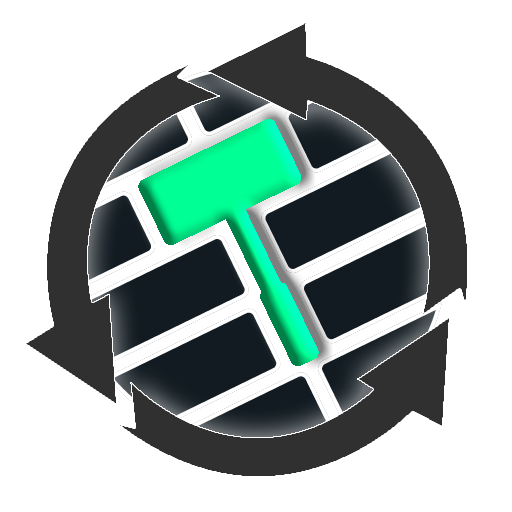
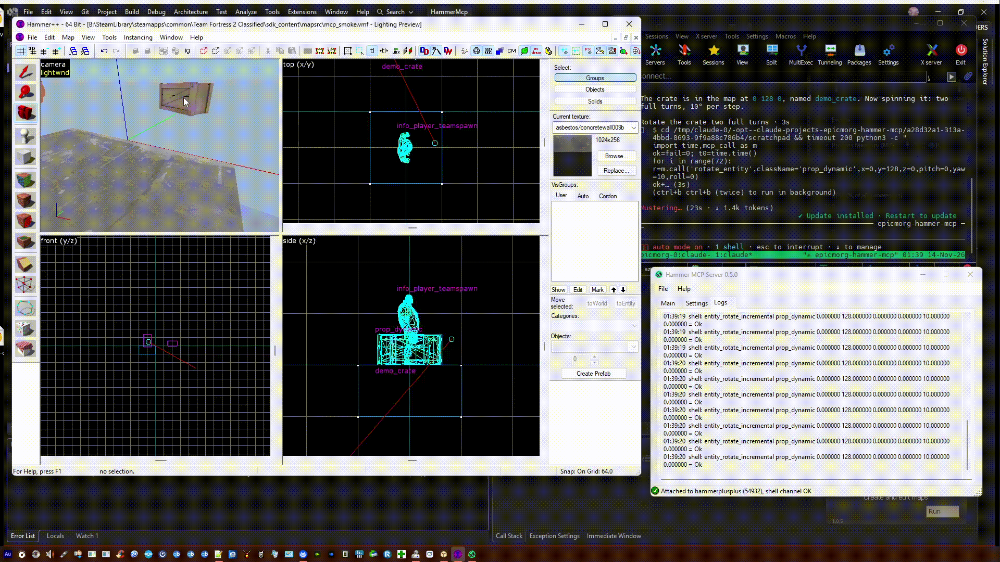
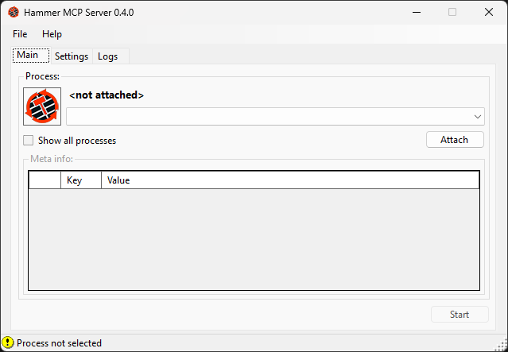
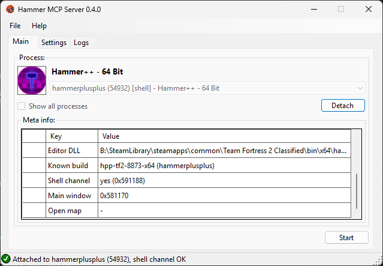
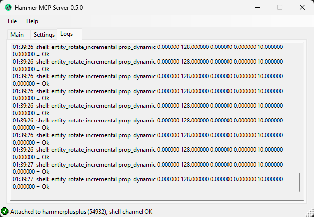

<p align="center">
  
</p>

<h1 align="center">Hammer-MCP</h1>

<p align="center">
  <b>ИИ-агент видит и правит карты в Valve Hammer Editor — вживую.</b><br>
  <a href="https://modelcontextprotocol.io">MCP</a>-сервер для Hammer (Source 1), <a href="https://github.com/ficool2/HammerPlusPlus-Website">Hammer++</a> и родственных редакторов.
</p>

<p align="center"><a href="README.md">English</a> · <b>Русский</b></p>

<p align="center">
  
  
  
  
  
</p>

---

Попросите агента *«поставь тёплый свет в каждый угол комнаты и назови по схеме»* — и сущности появятся в уже
открытом Hammer. Без плагинов и патченого редактора: Hammer-MCP общается с Hammer через **shell-канал**, который
Valve встроила в редактор 20 лет назад (`Worldcraft_ShellMessageWnd`, механизм за
[`editor_sendcommand.cpp`](https://github.com/ValveSoftware/source-sdk-2013/blob/master/src/public/editor_sendcommand.cpp) в Source SDK), и через собственные команды меню Hammer.

<p align="center">
  <br>
  <sub>Агент создаёт <code>prop_dynamic</code> в Hammer++ и вращает его — вживую, через MCP (<a href="docs/media/demo/demo.mp4">видео</a>).</sub>
</p>

```
 ИИ-агент (Claude Code, Cursor, …)
        │  MCP поверх HTTP (+ необязательный Bearer-токен, работает по локальной сети)
        ▼
 ┌────────────────────────────┐      WM_COPYDATA  (shell-канал: сущности, keyvalues, ноды)
 │  hammer-mcp.exe  (трей)    │ ───► WM_COMMAND   (меню: save, undo, redo, run map, …)        ──►  Hammer / Hammer++
 │  attach к процессу · настр.│ ───► читает сохранённый .vmf (сводка карты, mapversion)
 │  живой лог                 │
 └────────────────────────────┘
```

## Что уже работает

Проверено вживую на **[Hammer++](https://github.com/ficool2/HammerPlusPlus-Website) 8873** x64 ([TF2 Classified](https://store.steampowered.com/app/3545060/)) и x86 (мод на Source SDK 2013 SP), агентом с другой машины по локальной сети:

| | |
|---|---|
| ✅ Создание точечных сущностей с keyvalues (`light`, `info_target`, `prop_dynamic` с моделью, …) | ✅ Вращение сущностей (крутящийся шкаф ~28 правок/с, Hammer не тормозит) |
| ✅ Изменение keyvalues, удаление сущностей | ✅ Правки попадают в историю **undo** Hammer — Ctrl+Z работает |
| ✅ Save / undo / redo / Run Map / Check for Problems через команды меню | ✅ Сводка карты из сохранённого `.vmf` (сущности, браши, классы, skybox…) |
| ✅ Узнаёт запущенную сборку Hammer по хэшу (реестр из 179 известных сборок) | ✅ Авторизация по токену, по умолчанию только localhost |
| ✅ Знание карты: сущности, outputs, граф логики, проверка по FGD игры | ✅ Компиляция собственными Run Map-последовательностями Hammer, разбор лога, путь утечки, сущности скомпилированного `.bsp` |

### Скриншоты

| Выбор процесса Hammer | Подключено: сборка, shell-канал | Живой лог демо |
|---|---|---|
|  |  |  |

## Поддерживаемые редакторы

Shell-канал есть во **всех стоковых Source-Hammer с 2006 года** и в **Hammer++ начиная со сборки 8867**;
идентификаторы команд меню одинаковы во **всех 152 проанализированных сборках Source Hammer**.

| Редактор | Живые правки (shell) | Команды меню | Файлы карт |
|---|:---:|:---:|:---:|
| Стоковый Hammer — Source SDK 2013 SP/MP, HL2, Portal, TF2, CS:S, DoD:S, L4D/L4D2, Portal 2, GMod, … (x86 и x64) | ✅ | ✅ | ✅ |
| [Hammer++](https://github.com/ficool2/HammerPlusPlus-Website) 8867+ (все игры) | ✅ | ✅ | ✅ |
| [Slammin' Hammer 5.2](https://developer.valvesoftware.com/wiki/Slammin'_Source_Map_Tools), Black Mesa, Nuclear Dawn | ✅ | ✅ | ✅ |
| Hammer++ ≤ 8866 | — | ✅ | ✅ |
| [Strata](https://github.com/StrataSource) Hammer (Portal: Revolution, P2CE, …) | — | ✅ | ✅ |
| Hammer Source 2 (CS2, Dota 2, …) — распознаётся, `.vmap` и FGD читаются | — | — | ✅ чтение |
| GoldSrc: Worldcraft 1.1–3.3, Hammer 3.4 / 3.5 и его моды (Neon, Neo, CSM) — распознаются; [J.A.C.K.](https://store.steampowered.com/app/496450/) | — | частично | чтение RMF / MAP |

Статический анализ; вживую пока проверен Hammer++ 8873 (x64 и x86). Отчёты по другим сборкам очень приветствуются.

## Быстрый старт

1. Скачайте или соберите `hammer-mcp.exe` и запустите — он живёт в трее.
2. **Settings:** выберите режим, адрес (по умолчанию `localhost`), порт (`47800`), для локальной сети сгенерируйте токен → **Apply**.
3. **Main:** выберите процесс Hammer → **Attach** (в мета-информации видны сборка, shell-канал, открытая карта) → **Start**
   (Start доступен только после Attach; Apply на вкладке Settings активна, только когда что-то изменилось).
4. Подключите агента — меню трея → *Copy client config*:
   ```bash
   claude mcp add --transport http hammer http://127.0.0.1:47800/mcp
   # по сети:   ... http://10.0.0.5:47800/mcp --header "Authorization: Bearer <token>"
   ```
5. Откройте карту в Hammer и **сохраните её** (сессии привязаны к сохранённому `mapversion`). Можно спрашивать.

### Без приложения в трее: `hammer-mcp-cli`

В релизе есть и `hammer-mcp-cli.exe` — тот же сервер для MCP-клиентов, которые сами запускают серверы (stdio):

```json
{ "mcpServers": { "hammer": { "command": "C:\\Tools\\hammer-mcp-cli.exe", "args": ["--stdio", "--auto"] } } }
```

`--auto` подключается к первому запущенному Hammer с shell-каналом, `--pid N` — к заданному процессу; `--mode Basic` — только чтение;
`--http --port 47800` — HTTP, как у приложения. `Dockerfile` собирает его для каталогов MCP (самому Hammer нужна Windows).

## Инструменты для агента

| Инструмент | Что делает |
|---|---|
| `hammer_status` | Какой Hammer подключён, его сборка, shell-канал, открытая карта, сохранённый `mapversion`, разрешённый режим |
| `map_summary` | Сохранённый `.vmf`: версии, число сущностей и брашей, классы, skybox, visgroups |
| `list_entities` · `get_entity` · `find_io` | Сохранённая карта: сущности с keyvalues и outputs, кто кого вызывает |
| `game_configs` · `fgd_class` · `fgd_search` | Игровой конфиг Hammer и FGD игры как справочник сущностей (keyvalues, варианты, inputs, outputs) |
| `validate_map` | Сохранённая карта против FGD: неизвестные классы, outputs на несуществующие имена, неизвестные inputs / outputs, лишние keyvalues, значения с кавычками внутри |
| `check_assets` | Материалы, модели, оверлеи, декали, skybox сохранённой карты против путей поиска игры (gameinfo.txt, папки, VPK) |
| `compile_sequences` · `compile_log` · `leak_trace` | Собственные Run Map-последовательности Hammer (CmdSeq.wc / Hammer++ / Strata), разобранный лог компиляции, путь утечки из .lin |
| `bsp_entities` | Сущности в том виде, в каком vbsp записал их в скомпилированный .bsp (entity lump), вместе с outputs |
| `source2_console` | Только Source 2: команды консоли разработчика из белого списка через VConsole2 (открытые карты, принудительный автосейв, справка) |
| `run_compile` | Запускает одну из этих последовательностей (vbsp / vvis / vrad, копирование .bsp); только в режимах с правками |
| `create_entity` | Точечная сущность в x y z, с keyvalues |
| `set_keyvalue` · `rotate_entity` · `delete_entity` | Правка сущности заданного класса в заданной точке |
| `save_map` · `undo` · `redo` | Команды меню Hammer |
| `open_run_map_dialog` · `open_check_for_problems` | Открыть эти диалоги Hammer для пользователя |

**Режимы:** *Auto* (живые правки там, где есть shell-канал) · *Basic* (только чтение) · *Shell* (живые правки + меню) ·
*Advanced* (в планах: внедряемые адаптеры для чтения на лету, выделения, камеры, геометрии).

### Ограничения shell-канала
Канал только на запись и работает на уровне сущностей: сущность адресуется **классом + координатами** (без id), браши и
брашевые сущности создать нельзя, «переместить» нельзя, несохранённое состояние прочитать нельзя — сервер читает
сохранённый `.vmf`. Outputs, заданные через `set_keyvalue`, Hammer хранит как обычные keyvalues: на вкладке Outputs
их не видно, но vbsp пишет их в `.bsp` как настоящие outputs, и в игре они срабатывают.
Планируемый режим *Advanced* снимет эти ограничения для выбранных сборок. Внедрение будет только в отдельный exe
Hammer известной сборки (`hammer.exe`, `hammerplusplus.exe`) — **никогда в игровой процесс**: Hammer Source 2 работает
внутри `cs2.exe` / `dota2.exe`, а вмешательство в процесс под VAC может стоить бана аккаунта Steam.

## Безопасность и VAC

Hammer-MCP рассчитан на безопасную работу рядом с играми под Valve Anti-Cheat.

- **Source 1, Hammer++, Strata, GoldSrc:** Hammer — отдельный процесс (`hammer.exe`, `hammerplusplus.exe`, …), а не
  игра. Shell-канал и команды меню — это оконные сообщения процессу редактора; игру, запущенную через Run Map,
  Hammer-MCP не трогает.
- **Source 2 (CS2, Dota 2, HL: Alyx):** Hammer работает *внутри* игрового процесса (`cs2.exe`, …). Hammer-MCP делает
  с ним только то же, что Диспетчер задач или OBS: читает путь к exe, заголовки окон и командную строку
  (`OpenProcess` с правами только на чтение сведений), а карту и данные игры читает с диска (`.vmap`, FGD).
  В память игры он не пишет, ничего не перехватывает и не внедряет.
- **Внедрение** (планируемый режим *Advanced*) ограничено в коде (`InjectPolicy`) отдельными exe Hammer известных
  сборок — никогда в игровые процессы, никогда в Source 2, никогда в неизвестные сборки.
- **`-insecure` не обязателен.** Режим Workshop Tools (`-tools`) и так ведёт себя как небезопасный клиент: CS2 в нём
  не пускает на VAC-серверы (проверено вживую, 2026-11). Можно добавить `-insecure` в параметры запуска для
  спокойствия, но потом обязательно уберите его — иначе не попадёте в матчмейкинг и на VAC-серверы.

## Сборка

```bash
cd src
dotnet build HammerMcp.sln
dotnet test --solution HammerMcp.sln
```
.NET 10 SDK. Приложение и сервер — `net10.0-windows` (собираются и на Linux через `EnableWindowsTargeting`, запускаются на Windows 10/11 x64).

```
src/src/HammerMcp.Core      форматы (VMF с outputs, RMF/MAP через Sledge, терпимый парсер FGD с расширениями
                            Hammer++/GMod, VMT, игровые конфиги Hammer), проверка карт, реестр сборок, id меню
src/src/HammerMcp.Shell     shell-канал (WM_COPYDATA), команды меню (WM_COMMAND), сессии, поиск процессов
src/src/HammerMcp.Server    MCP-сервер (Streamable HTTP, Bearer-токен) и инструменты
src/src/HammerMcp.App       hammer-mcp.exe — окно WinForms + трей
src/src/HammerMcp.Cli       hammer-mcp-cli.exe — сервер без приложения в трее (stdio / HTTP)
src/tests/HammerMcp.Tests   модульные тесты
src/registry/hammers.json   известные сборки Hammer
src/native/                 C++ инжектор и адаптеры (в планах, CMake)
```

## Дорожная карта

- [x] Shell-канал: сущности, keyvalues, вращение, удаление · команды меню · реестр сборок · приложение в трее · сеть + токен
- [x] Чтение карты: сущности, outputs, граф логики; справочник FGD по игровому конфигу Hammer; проверка карты; защита от неоднозначной адресации перед правками
- [x] Компиляция: Run Map-последовательности Hammer, run_compile, разбор логов, путь утечки; проверка ассетов по gameinfo.txt + VPK
- [x] Релизы 0.1 – 0.6: однофайловая сборка `win-x64` — см. [CHANGELOG.ru.md](CHANGELOG.ru.md)
- [ ] Режим *Advanced*: C++-адаптеры для внедрения под каждую сборку (чтение на лету, выделение, камера, геометрия, UI в редакторе)

## Релизы

Тег `vX.Y.Z[-suffix]` на GitHub → workflow `release` собирает самодостаточный однофайловый `hammer-mcp.exe`
(win-x64, ~65 МБ) и прикладывает zip к релизу GitHub (теги `-alpha` / `-beta` становятся пре-релизами).
Текст релиза берётся из [CHANGELOG.md](CHANGELOG.md). Как помочь, сообщить о новой сборке Hammer или баге: [CONTRIBUTING.md](CONTRIBUTING.md); безопасность: [SECURITY.md](SECURITY.md). Компоненты и лицензии: [THIRD-PARTY-NOTICES.md](THIRD-PARTY-NOTICES.md).

## Благодарности и правовое

Сделано [EpicMorg](https://github.com/EpicMorg). Протокол shell-канала — в том виде, в каком Valve опубликовала его в
[Source SDK 2013](https://github.com/ValveSoftware/source-sdk-2013) (`src/public/editor_sendcommand.{h,cpp}`).
Статья на Valve Developer Community: [Hammer MCP Server](https://developer.valvesoftware.com/wiki/Ru/Hammer_MCP_Server) ([на английском](https://developer.valvesoftware.com/wiki/Hammer_MCP_Server)).
Спасибо [ficool2](https://github.com/ficool2) за [Hammer++](https://github.com/ficool2/HammerPlusPlus-Website) и
[Valve Developer Community](https://developer.valvesoftware.com/wiki/Hammer).
Hammer-MCP не содержит исходного кода Valve и утёкшего кода; с редакторами он общается только через их открытые
встроенные интерфейсы. Проект не связан с Valve и не одобрен ею. Hammer, Source и связанные знаки принадлежат Valve Corporation.

MIT — см. [LICENSE](LICENSE).
