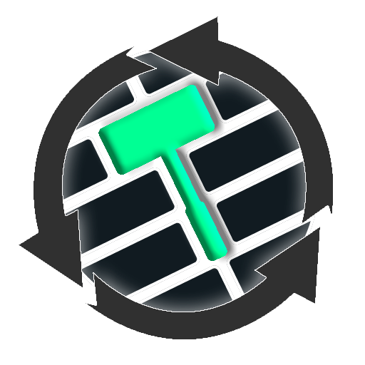
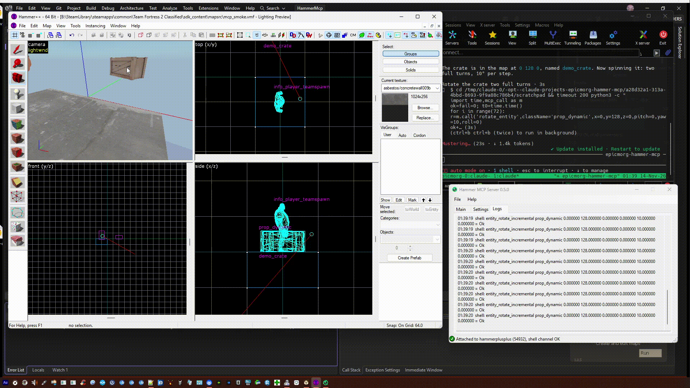
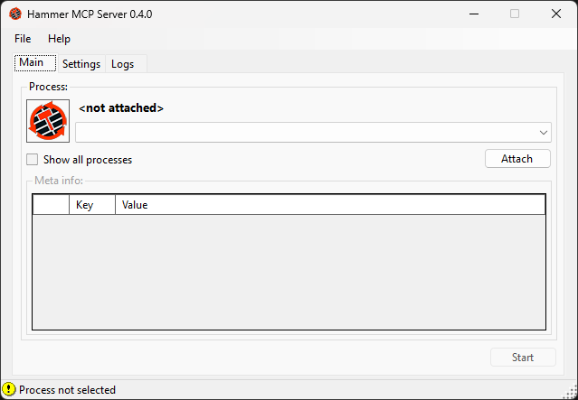
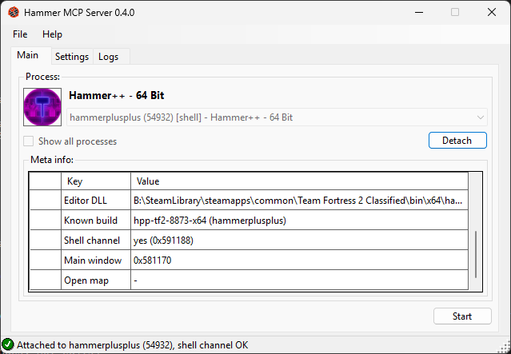
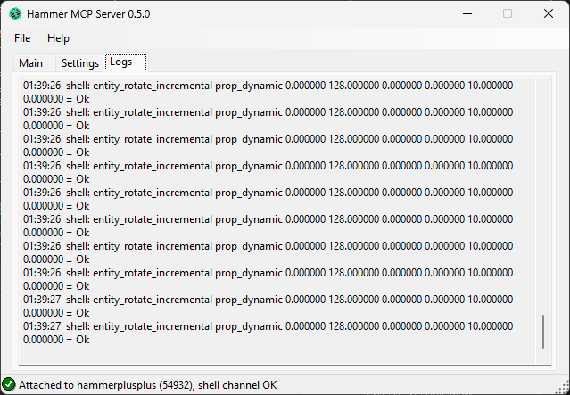

<p align="center">
  
</p>

<h1 align="center">Hammer-MCP</h1>

<p align="center">
  <b>ИИ-агент видит и правит карты в Valve Hammer Editor — вживую.</b><br>
  <a href="https://modelcontextprotocol.io">MCP</a>-сервер для Hammer (Source 1), <a href="https://github.com/ficool2/HammerPlusPlus-Website">Hammer++</a> и родственных редакторов.
</p>

<p align="center"><a href="README.md">English</a> · <b>Русский</b></p>

<p align="center">
  
  
  
  
  
  <a href="https://glama.ai/mcp/servers/EpicMorg/Hammer-MCP"></a>
</p>

---

Попросите агента *«поставь тёплый свет в каждый угол комнаты и назови по схеме»* — и сущности появятся в уже
открытом Hammer. Без плагинов и патченого редактора: Hammer-MCP общается с Hammer через **shell-канал**, который
Valve встроила в редактор 20 лет назад (`Worldcraft_ShellMessageWnd`, механизм за
[`editor_sendcommand.cpp`](https://github.com/ValveSoftware/source-sdk-2013/blob/master/src/public/editor_sendcommand.cpp) в Source SDK), и через собственные команды меню Hammer.

<p align="center">
  <br>
  <sub>Агент создаёт <code>prop_dynamic</code> в Hammer++ и вращает его — вживую, через MCP (<a href="docs/media/demo/demo.mp4">видео</a>).</sub>
</p>

```
 ИИ-агент (Claude Code, Cursor, …)
        │  MCP поверх HTTP (+ необязательный Bearer-токен, работает по локальной сети)
        ▼
 ┌────────────────────────────┐      WM_COPYDATA  (shell-канал: сущности, keyvalues, ноды)
 │  hammer-mcp.exe  (трей)    │ ───► WM_COMMAND   (меню: save, undo, redo, run map, …)        ──►  Hammer / Hammer++
 │  attach к процессу · настр.│ ───► читает сохранённый .vmf (сводка карты, mapversion)
 │  живой лог                 │
 └────────────────────────────┘
```

## Что уже работает

Проверено вживую на **[Hammer++](https://github.com/ficool2/HammerPlusPlus-Website) 8873** x64 ([TF2 Classified](https://store.steampowered.com/app/3545060/)) и x86 (мод на Source SDK 2013 SP), агентом с другой машины по локальной сети:

| | |
|---|---|
| ✅ Создание точечных сущностей с keyvalues (`light`, `info_target`, `prop_dynamic` с моделью, …) | ✅ Вращение сущностей (крутящийся шкаф ~28 правок/с, Hammer не тормозит) |
| ✅ Изменение keyvalues, удаление сущностей | ✅ Правки попадают в историю **undo** Hammer — Ctrl+Z работает |
| ✅ Save / undo / redo / Run Map / Check for Problems через команды меню | ✅ Сводка карты из сохранённого `.vmf` (сущности, браши, классы, skybox…) |
| ✅ Узнаёт запущенную сборку Hammer по хэшу (реестр из 183 известных сборок) | ✅ Авторизация по токену, по умолчанию только localhost |
| ✅ Знание карты: сущности, outputs, граф логики, проверка по FGD игры | ✅ Компиляция собственными Run Map-последовательностями Hammer, разбор лога, путь утечки, сущности скомпилированного `.bsp` |

### Скриншоты

| Выбор процесса Hammer | Подключено: сборка, shell-канал | Живой лог демо |
|---|---|---|
|  |  |  |

## Поддерживаемые редакторы

Shell-канал есть во **всех стоковых Source-Hammer с 2006 года** и в **Hammer++ начиная со сборки 8867**;
идентификаторы команд меню одинаковы во **всех 152 проанализированных сборках Source Hammer**. Начиная со следующего
релиза (0.9) адаптер на сборках с известной раскладкой памяти читает и живое выделение, и 3D-камеру.

| Редактор | Живые правки (shell) | Команды меню | Выделение и камера (адаптер, 0.9) | Файлы карт |
|---|:---:|:---:|:---:|:---:|
| [Hammer++](https://github.com/ficool2/HammerPlusPlus-Website) 8867+ (все игры, x86 и x64) | ✅ | ✅ | ✅ | ✅ |
| Hammer++ ≤ 8866 | — | ✅ | ✅ | ✅ |
| [Source Level Editor](https://developer.valvesoftware.com/wiki/Source_Level_Editor_(SLE)) 3.129 | ✅ | ✅ | ✅ | ✅ |
| Стоковый Hammer, ветка 2013 и новее — Source SDK 2013 SP/MP, HL2, TF2, CS:S, HL1, GMod, … (x86 и x64) | ✅ | ✅ | ✅ ² | ✅ |
| Стоковый Hammer, старые ветки — Orange Box, L4D/L4D2, Portal 2, Alien Swarm, CS:GO, … (EP1: выделение в работе) | ✅ | ✅ | ✅ ² | ✅ |
| [Slammin' Hammer 5.2](https://developer.valvesoftware.com/wiki/Slammin'_Source_Map_Tools), Black Mesa, Nuclear Dawn | ✅ | ✅ | ✅ ¹ ² | ✅ |
| [Strata](https://github.com/StrataSource) Hammer (Portal: Revolution, P2CE, …) | — | ✅ | — | ✅ |
| Hammer Source 2 (CS2, Dota 2, …) — распознаётся, `.vmap` и FGD читаются, несохранённое состояние через VConsole2 | — | — | — | ✅ чтение |
| GoldSrc: Hammer 3.4 / 3.5 и его моды (Neon, Neo, CSM) | — | ✅ | ✅ | чтение RMF / MAP |
| GoldSrc: Worldcraft 1.1–3.3; [J.A.C.K.](https://store.steampowered.com/app/496450/) | — | частично | — | чтение RMF / MAP |

¹ Включая Nuclear Dawn.
² Раскладка памяти выведена из бинарников, живая проверка впереди.

Вживую пока проверены (сборки 0.9 в разработке) Hammer++ 8873 (x64 и x86) и 8862, Source Level Editor 3.129, Valve Hammer Editor 3.4 и 3.5,
CS2; остальное — статический анализ бинарников. Подробно по сборкам, что проверено вживую, а что нет:
**[таблица поддержки редакторов](docs/editors.ru.md)**. Отчёты по другим сборкам очень приветствуются.

## Быстрый старт

1. Скачайте или соберите `hammer-mcp.exe` и запустите — он живёт в трее.
2. **Settings:** выберите режим, адрес (по умолчанию `localhost`), порт (`47800`), для локальной сети сгенерируйте токен → **Apply**.
3. **Main:** выберите процесс Hammer → **Attach** (в мета-информации видны сборка, shell-канал, открытая карта) → **Start**
   (Start доступен только после Attach; Apply на вкладке Settings активна, только когда что-то изменилось).
4. Подключите агента — меню трея → *Copy client config*:
   ```bash
   claude mcp add --transport http hammer http://127.0.0.1:47800/mcp
   # по сети:   ... http://10.0.0.5:47800/mcp --header "Authorization: Bearer <token>"
   ```
5. Откройте карту в Hammer и **сохраните её** (сессии привязаны к сохранённому `mapversion`). Можно спрашивать.

**Oh My Pi (OMP):** в трее выберите **Copy client config → Oh My Pi**. Добавьте запись `mcpServers.hammer`
в `.omp/mcp.json` проекта или в пользовательский `~/.omp/agent/mcp.json`. Затем выполните `/mcp reload`
и `/mcp test hammer` в OMP. Сервер в трее должен работать; если настроен токен, он уже есть в скопированной записи.
Для stdio вместо этого добавьте в тот же файл пример ниже.

### Без приложения в трее: `hammer-mcp-cli`

В релизе есть и `hammer-mcp-cli.exe` — тот же сервер для MCP-клиентов, которые сами запускают серверы (stdio):

```json
{ "mcpServers": { "hammer": { "command": "C:\\Tools\\hammer-mcp-cli.exe", "args": ["--stdio", "--auto"] } } }
```

`--auto` подключается к первому запущенному Hammer с shell-каналом, `--pid N` — к заданному процессу; `--mode Basic` — только чтение;
`--http --port 47800` — HTTP, как у приложения. `Dockerfile` собирает его для каталогов MCP (самому Hammer нужна Windows).

## Инструменты для агента

| Инструмент | Что делает |
|---|---|
| `hammer_status` | Какой Hammer подключён, его сборка, shell-канал, открытая карта, сохранённый `mapversion`, разрешённый режим |
| `viewport_capture` | PNG-снимки активной карты: 3D-вид (по умолчанию), `2d` или `all` в Valve Hammer и Hammer++ |
| `map_summary` | Сохранённый `.vmf`: версии, число сущностей и брашей, классы, skybox, visgroups |
| `list_entities` · `get_entity` · `find_io` | Сохранённая карта: сущности с keyvalues и outputs, кто кого вызывает |
| `game_configs` · `fgd_class` · `fgd_search` | Игровой конфиг Hammer и FGD игры как справочник сущностей (keyvalues, варианты, inputs, outputs) |
| `validate_map` | Сохранённая карта против FGD: неизвестные классы, outputs на несуществующие имена, неизвестные inputs / outputs, лишние keyvalues, значения с кавычками внутри |
| `check_assets` | Материалы, модели, оверлеи, декали, skybox, звуки и имена звуковых скриптов сохранённой карты против путей поиска игры (gameinfo.txt, папки, VPK) |
| `compile_sequences` · `compile_log` · `leak_trace` | Собственные Run Map-последовательности Hammer (CmdSeq.wc / Hammer++ / Strata / J.A.C.K.), разобранный лог компиляции, путь утечки из .lin |
| `bsp_entities` | Сущности в том виде, в каком vbsp записал их в скомпилированный .bsp (entity lump), вместе с outputs |
| `bsp_visibility` · `bsp_compare` | Офлайн-аудит BSP Source 1: зоны высокой видимости и сравнение двух сборок в одинаковых координатах |
| `source2_console` | Только Source 2: команды консоли разработчика из белого списка через VConsole2 (открытые карты, принудительный автосейв, справка) |
| `run_compile` | Запускает одну из этих последовательностей (vbsp / vvis / vrad, копирование .bsp); только в режимах с правками |
| `create_entity` | Точечная сущность в x y z, с keyvalues |
| `set_keyvalue` · `rotate_entity` · `delete_entity` | Правка сущности заданного класса в заданной точке |
| `list_live_brushes` | Несохранённая геометрия Source 1: ID брашей, их сущности, материалы и границы по точкам плоскостей |
| `move_brush` · `scale_brush` · `delete_brush` | Правка одного браша по LIVE ID или по текущему выделению |
| `save_map` · `undo` · `redo` | Команды меню Hammer |
| `open_run_map_dialog` · `open_check_for_problems` | Открыть эти диалоги Hammer для пользователя |
| `find_assets` | Найти модели, материалы, текстуры, звуки, имена звуковых скриптов, спрайты, частицы по имени в файлах игры и VPK (GoldSrc: файлы и текстуры / декали из WAD); возвращает, что писать в сущность |
| `user_requests` · `wait_for_user` · `say_to_user` | Чат в Hammer (с адаптером): прочитать строки пользователя, подождать ответа (до 10 мин), ответить |
| `pending_changes` | Режим подтверждения: что ждёт решения пользователя и что он решил |
| `hammer_selection` · `hammer_camera` (0.9) | С адаптером: что выделено в Hammer прямо сейчас (сущности с keyvalues, браши с гранями и текстурами) и куда смотрит 3D-вид |
| `hammer_ui` (0.9) | Что известно об интерфейсе подключённого Hammer: id меню и диалогов, проверенные пошаговые рецепты |
| `check_model_clipping` · `check_cubemaps` (0.9) | Сохранённая карта: пропы, чьи модели пересекаются с брашами или другими пропами (кандидаты на осмотр), настройки проекции `env_cubemap` |

**Режимы:** *Auto* (лучшее доступное: адаптер, если вы его подключили, иначе shell-канал, иначе только чтение) ·
*Basic* (только чтение) · *Shell* (живые правки + меню только через shell-канал) · *Advanced* (строгий режим «только адаптер», для отладки).

Для офлайн-оптимизации запустите `bsp_visibility` для несжатого BSP Source 1, собранного с VVIS. В топ могут
попасть внешние или недоступные зоны; для проверки используйте координаты внутри игровой области. Передайте
`beforePath`, `afterPath` и общие `points` (`{x,y,z}`) в `bsp_compare`. Собирайте обе версии с одинаковыми
настройками. Считаются уникальные грани мира в PVS, без пропов и брашевых сущностей; это не замер FPS.
Оба инструмента только читают файлы и не запускают игру.

Чтобы агент мог посмотреть на карту, вызовите `viewport_capture` в OMP или другом клиенте с поддержкой изображений
(например, `{"views":"all","maxSize":1024}`). Снимок показывает несохранённые правки, не меняя карту, камеру и
режим отображения. Не сворачивайте Hammer. Если Valve Hammer не отдаёт 3D-кадр, выведите его на передний план
и наведите камеру на карту. Требуется Windows 10 версии 1607 или новее. Снимок не включает рабочий стол.
В режиме Advanced инструмент недоступен.

### LIVE-правки брашей в Valve Hammer и Hammer++

Используйте режим **Auto** или **Shell**. Для ручного выбора выделите в Hammer один браш и не передавайте `brushId`.
Для автоматического выбора вызовите `list_live_brushes` (можно указать фильтр `material`), затем передайте `id`
видимого браша как `brushId`. `move_brush` принимает смещение в единицах Hammer, `scale_brush` — положительные
коэффициенты по X/Y/Z.

Инструменты используют штатные английские диалоги и строку состояния редактора. Оставляйте строку состояния видимой,
не переключайте карту и не меняйте выделение во время вызова. Valve Hammer может отказаться править неоднозначное
выделение; в этом случае укажите ID. В режиме подтверждения сервер перепроверяет исходный браш перед применением.
Правки идут в штатную историю Undo, если она включена. Список брашей читается из временного снимка открытой карты:
он не перезаписывает и не перезагружает её VMF. Чтобы сохранить правки на диск, явно вызовите `save_map`.

### Адаптер (0.7+)
**Connect adapter** в приложении (режимы Auto или Advanced) внедряет в подключённый Hammer небольшой нативный адаптер —
только по нажатию кнопки и только в отдельный exe Hammer известной сборки. Он добавляет в Hammer меню **MCP**: пауза
агента, **чат с агентом**, живой **журнал действий**, **ожидающие правки** с галочками (режим подтверждения), отмена шага
агента, статус, отключение. Работаете в OpenCode? Вкладка **OpenCode** в приложении отправляет строки чата в сессию
OpenCode, и агент там просыпается и отвечает. **Disconnect** выгружает адаптер, Hammer продолжает работать. Начиная с 0.9
на сборках с известной раскладкой памяти адаптер также читает **живое выделение** и **3D-камеру** (`hammer_selection`,
`hammer_camera`) — см. [таблицу поддержки редакторов](docs/editors.ru.md). Папка `native` из архива должна лежать рядом с `hammer-mcp.exe`.

### Ограничения shell-канала

**[Справочник по shell-каналу](https://github.com/EpicMorg/HammerShell/blob/master/docs/shell-channel.ru.md)** рассказывает, откуда канал взялся (открытый код Source SDK с
2006 года), как отправлять команды, про сессии, все команды и чего канал не умеет — пригодится любому автору
инструментов, не только Hammer-MCP.

Канал только на запись и работает на уровне сущностей: сущность адресуется **классом + координатами** (без id), браши и
брашевые сущности создать нельзя, «переместить» нельзя, несохранённое состояние прочитать нельзя — сервер читает
сохранённый `.vmf`. Outputs, заданные через `set_keyvalue`, Hammer хранит как обычные keyvalues: на вкладке Outputs
их не видно, но vbsp пишет их в `.bsp` как настоящие outputs, и в игре они срабатывают.
Начиная с 0.9 адаптер снимает часть этих ограничений (живое выделение и камера). Внедряется он только в отдельный exe
Hammer известной сборки (`hammer.exe`, `hammerplusplus.exe`) — **никогда в игровой процесс**: Hammer Source 2 работает
внутри `cs2.exe` / `dota2.exe`, а вмешательство в процесс под VAC может стоить бана аккаунта Steam.

## Безопасность и VAC

Hammer-MCP рассчитан на безопасную работу рядом с играми под Valve Anti-Cheat.

- **Source 1, Hammer++, Strata, GoldSrc:** Hammer — отдельный процесс (`hammer.exe`, `hammerplusplus.exe`, …), а не
  игра. Shell-канал и команды меню — это оконные сообщения процессу редактора; игру, запущенную через Run Map,
  Hammer-MCP не трогает.
- **Source 2 (CS2, Dota 2, HL: Alyx):** Hammer работает *внутри* игрового процесса (`cs2.exe`, …). Hammer-MCP делает
  с ним только то же, что Диспетчер задач или OBS: читает путь к exe, заголовки окон и командную строку
  (`OpenProcess` с правами только на чтение сведений), а карту и данные игры читает с диска (`.vmap`, FGD).
  В память игры он не пишет, ничего не перехватывает и не внедряет.
- **Внедрение** (адаптер) — только по кнопке **Connect adapter** и ограничено в коде (политика приложения и повторная
  проверка в нативном инжекторе) отдельными exe Hammer известных сборок — никогда в игровые процессы, никогда в
  Source 2, никогда в неизвестные сборки. Без кнопки ничего не внедряется.
- **`-insecure` не обязателен.** Режим Workshop Tools (`-tools`) и так ведёт себя как небезопасный клиент: CS2 в нём
  не пускает на VAC-серверы (проверено вживую, 2026-11). Можно добавить `-insecure` в параметры запуска для
  спокойствия, но потом обязательно уберите его — иначе не попадёте в матчмейкинг и на VAC-серверы.

## Сборка

```bash
cd src
dotnet build HammerMcp.sln
dotnet test --solution HammerMcp.sln
```
.NET 10 SDK. Приложение и сервер — `net10.0-windows` (собираются и на Linux через `EnableWindowsTargeting`, запускаются на Windows 10/11 x64).

```
src/src/HammerMcp.Core      форматы (VMF с outputs, RMF/MAP через Sledge, терпимый парсер FGD с расширениями
                            Hammer++/GMod, VMT, игровые конфиги Hammer), проверка карт, реестр сборок, id меню
src/src/HammerMcp.Shell     команды меню (WM_COMMAND), поиск процессов; shell-канал (WM_COPYDATA, сессии) в 0.8
                            находится здесь, а в 0.9 переезжает в отдельную библиотеку HammerShell.Client
                            (см. docs/shell-channel.ru.md)
src/src/HammerMcp.Server    MCP-сервер (Streamable HTTP, Bearer-токен) и инструменты
src/src/HammerMcp.App       hammer-mcp.exe — окно WinForms + трей
src/src/HammerMcp.Cli       hammer-mcp-cli.exe — сервер без приложения в трее (stdio / HTTP)
src/tests/HammerMcp.Tests   модульные тесты
src/registry/hammers.json   известные сборки Hammer
src/native/                 C++ инжектор и адаптер (CMake; MSVC или clang-cl), см. src/native/PROTOCOL.md
```

## Дорожная карта

- [x] Shell-канал: сущности, keyvalues, вращение, удаление · команды меню · реестр сборок · приложение в трее · сеть + токен
- [x] Чтение карты: сущности, outputs, граф логики; справочник FGD по игровому конфигу Hammer; проверка карты; защита от неоднозначной адресации перед правками
- [x] Компиляция: Run Map-последовательности Hammer, run_compile, разбор логов, путь утечки; проверка ассетов по gameinfo.txt + VPK
- [x] Релизы 0.1 – 0.8: однофайловые сборки `win-x64` и `win-x86` — см. [CHANGELOG.ru.md](CHANGELOG.ru.md)
- [x] Адаптер, слой 1 (0.7): меню MCP в Hammer, чат, живой журнал, список подтверждения
- [x] Адаптер, слой 2 (0.9): живое чтение выделения и 3D-камеры (раскладки памяти по сборкам; Hammer++, стоковый Source Hammer всех веток начиная с Orange Box, SLE, GoldSrc 3.4 / 3.5)
- [ ] Слой 2 для Episode One; живые проверки статических раскладок; док-панели в Hammer
- [ ] Картинки вьюпортов, живая правка брашей, аудит видимости BSP (из [форка HammerOMP-MCP](https://github.com/EpicMorg/Hammer-MCP/issues/1))
- [ ] Проверки кубмапов и проникновения моделей с осмотром через камеру

## Релизы

Тег `vX.Y.Z[-suffix]` на GitHub → workflow `release` собирает самодостаточный однофайловый `hammer-mcp.exe`
плюс `hammer-mcp-cli.exe` и нативный адаптер (win-x64 и win-x86) и прикладывает архивы к релизу GitHub (теги `-alpha` / `-beta` становятся пре-релизами).
Текст релиза берётся из [CHANGELOG.md](CHANGELOG.md). Как помочь, сообщить о новой сборке Hammer или баге: [CONTRIBUTING.md](CONTRIBUTING.md); безопасность: [SECURITY.md](SECURITY.md). Компоненты и лицензии: [THIRD-PARTY-NOTICES.md](THIRD-PARTY-NOTICES.md).

## Ссылки

| Где | Что |
|---|---|
| [Релизы на GitHub](https://github.com/EpicMorg/Hammer-MCP/releases) | Скачать (архивы win-x64 / win-x86: `hammer-mcp.exe`, `hammer-mcp-cli.exe`, `native\`) и что нового |
| [Valve Developer Community](https://developer.valvesoftware.com/wiki/Ru/Hammer_MCP_Server) ([EN](https://developer.valvesoftware.com/wiki/Hammer_MCP_Server)) | Статья об инструменте |
| [GameBanana](https://gamebanana.com/tools/24946) | Страница инструмента для мапперов |
| [HL-Lab](https://hl-lab.ru/rus/files_source/Hammer_MCP_Server) | Страница инструмента на русском сайте мапперов Half-Life / Source |
| [Glama](https://glama.ai/mcp/servers/EpicMorg/Hammer-MCP) | Карточка MCP-сервера и оценка |
| [Issues](https://github.com/EpicMorg/Hammer-MCP/issues) | Ошибки, неизвестные сборки Hammer ([как сообщить](CONTRIBUTING.md)) |

## Благодарности и правовое

Сделано [EpicMorg](https://github.com/EpicMorg). Протокол shell-канала — в том виде, в каком Valve опубликовала его в
[Source SDK 2013](https://github.com/ValveSoftware/source-sdk-2013) (`src/public/editor_sendcommand.{h,cpp}`).
Спасибо [ficool2](https://github.com/ficool2) за [Hammer++](https://github.com/ficool2/HammerPlusPlus-Website) и
[Valve Developer Community](https://developer.valvesoftware.com/wiki/Hammer).
Hammer-MCP не содержит исходного кода Valve и утёкшего кода; с редакторами он общается только через их открытые
встроенные интерфейсы. Проект не связан с Valve и не одобрен ею. Hammer, Source и связанные знаки принадлежат Valve Corporation.

MIT — см. [LICENSE](LICENSE).
